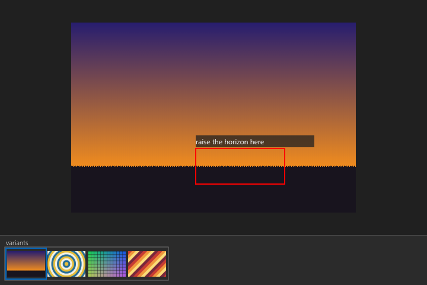
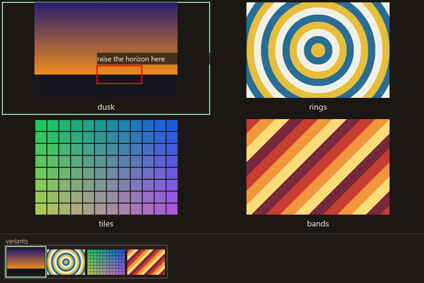

# Seer

[](https://github.com/RKeelan/Seer/actions/workflows/ci.yml)

Seer is a fast image viewer for Windows that shows the images it was asked to open and nothing else, in one window, and that agents can drive and read back from.



## Using Seer

Seer runs on Windows 11, x64. It is two programs: `seerw.exe` is the viewer, which owns the window, and `seer.exe` is the command line that drives it.

### Installing

Download the zip from the latest [release](https://github.com/RKeelan/Seer/releases), unzip it anywhere, and run `seer install` from that directory. It installs Seer for the current user, without administrator rights:

- It copies both programs to `%LOCALAPPDATA%\Programs\Seer` and adds that directory to your `PATH`, so terminals opened afterwards find `seer`.
- It registers Seer for the image types it reads, so it appears in Explorer's Open with menu and in Settings > Apps > Default apps. It never makes itself the default: choose it there, or in Open with > Choose another app, for each type you want it to open.
- It registers the open verb so that Explorer hands a whole selection to one `seerw.exe` through COM. The images join the window in the folder's order, whatever it is sorted by, and the one that had the focus is selected. The COM class is a local server in `seerw.exe`, registered for the current user only.
- It adds Seer, with its version, to Settings > Apps > Installed apps.

Installing again replaces the programs, even while the viewer is running; the running viewer keeps its old version until it is next started. `seer uninstall`, or uninstalling Seer from Installed apps, removes the programs, the `PATH` entry and the registrations, and leaves other programs' registrations for the same types alone. The directory the zip was unpacked to can then be deleted.

### Opening images

Double-click an image in Explorer, or select several and press Enter, once Seer is the default app for their type. Whichever way images arrive, they join the one window, in the order they were opened; opening an image that is already there selects it. Closing the window forgets the images and their marks.

- `seer --version` and `seerw --version` print the program's name and version.
- `seerw <files…>` opens a window showing the first image, fitted to the window and never enlarged, with the others a key press away. A large image appears at window size first and sharpens once its full-resolution decode finishes. The title bar shows the image's file name and size in pixels.
- A folder given to `seerw` or `seer open` stands for the images directly in it, which open in the order Explorer sorts them by name (so `shot2.png` comes before `shot10.png`). Files Seer does not read, hidden files and subfolders are left out. The folder is listed once, when it is opened: images added to it later do not join the window. A folder with no images fails with `no_images`, and a folder cannot have a `--caption`. A folder in a selection opened from Explorer is left out.
- While an image is shown, the images either side of it are decoded in the background, so moving to one shows it at once. Decoded images are kept in memory up to a quarter of the machine's memory, at most 2 GB; beyond that, those shown longest ago are dropped and decoded again when needed. Images further away are not decoded until they are near the one shown.
- With more than one image open, a strip of thumbnails along the bottom of the window shows them all in order, the shown one outlined, and each group bracketed under its name. The strip scrolls to keep the shown image in view; the wheel over it scrolls it, and clicking a thumbnail shows that image. Thumbnails are decoded on a thread of their own at background priority, so they never hold up the shown image, and only those the strip shows are decoded. They are small, so they are kept for as long as their image is open.
- `seerw` with no files starts the viewer empty. It shows its window once it has been sent an image and drawn it, or after a second with nothing to show.
- `seerw --headless` runs the viewer without ever showing its window or taking the focus, for tests. It answers the command line like any viewer, and also accepts `seer debug input`.
- `--no-activate` shows the window without taking the focus.

The window follows Windows' light or dark setting for apps, title bar and note field included, and switches when the setting changes. A headless viewer is always dark.

A fitted image stays fitted as the window is resized; otherwise the point at the middle of the window stays there. Moved to a monitor with a different scale, the window keeps its size to the eye and its text and controls scale with it. If the graphics driver restarts or is updated, the viewer moves to a new device and carries on.

Seer reads every still format the Windows Imaging Component can decode: JPEG, PNG, BMP, TIFF, ICO and JPEG XR, plus WebP, HEIC, AVIF and JPEG XL when their codec extensions from the Microsoft Store are installed. An image whose codec is missing shows a message naming the extension to install, and `seer open` reports it as failed with the same message. EXIF orientation is honoured.

Animated GIFs play while they are shown, and pause when they are not. As in a browser, a frame with a delay of 10 ms or less shows for 100 ms, a GIF with no loop count plays once, and one with a loop count of n plays n + 1 times (0 means forever). An animation's frames are held in memory whole, up to 1 GB, and count in full towards the memory kept for decoded images.

SVG files are drawn as vectors, so they stay sharp at any zoom. Their size in pixels, which `seer list` reports, is the root element's `width` and `height`, or its `viewBox` where those are missing or not plain numbers, or 300 × 150.

When an open image's file is written, Seer reloads it once the writing stops, keeping the zoom, position, rotation and marks; if the size changed, the same relative point stays in the middle. A file that is locked or only partly written is tried again after a short wait, and the old image stays on screen meanwhile. Until the new file is decoded, `seer list` reports the image as `preview`. An image that is neither shown nor next to the one shown is reloaded only once it is. A deleted file stays open showing its last image, and `seer list` reports it as missing. Seer closes each file once it has read it, so it never stops another program from writing or deleting it, and it watches only the open files, through change notifications on their folders.

### The command line

There is only ever one viewer window. The first `seerw.exe` to start owns it; any later one hands its files to the first, brings its window to the front, and exits. Many started at once all end up in the one window, in the order they reach it. `seer.exe` talks to the viewer over a named pipe that only the current user can open and that refuses connections from other machines.

- `seer open [--group G] [--caption C]… [--compare] [--activate] <files…>` adds images to the window, starting the viewer if none is running, and reports the id given to each. A folder opens the images in it, as above, each reported on its own. The nth `--caption` belongs to the nth file. Without `--activate` the window does not take the focus: a running viewer flashes its taskbar button, and a new one shows behind the active window.
- `seer list` reports the open images (id, path, caption, group, size, load state and whether the file is missing), which one is selected, the zoom, the visible region and whether compare view is on. An image not decoded yet, or dropped from memory, is `loading` until it is near the one shown.
- `seer close <id or path>…` removes images, and `seer close --all` removes them all. A bare number is an id; write `.\3` for a file named `3`. Naming an image that is not open is not an error: it is reported on stderr and in the JSON's `not_found`.
- `seer clear <group>` removes a group's images.
- `seer marks [--wait] [--timeout <seconds>] [--clear]` reports the marks the user has drawn: for each, its id, its image's id and path, its rectangle (`x`, `y`, `width`, `height` in the image's own pixels, whatever the zoom and rotation) and its note, in the order of the images and then the order the marks were made. `--wait` answers only once the user presses Ctrl+Enter, `--timeout` gives up after that many seconds (which may be fractional) with exit code 5, and `--clear` removes the marks once reported.
- `seer screenshot <out.png>` saves what the window shows.
- `seer quit` closes the viewer.
- `seer install` and `seer uninstall` install and remove Seer for the current user (see [Installing](#installing)).

Every command takes `--json`, which prints the result as JSON on stdout; errors then also appear there as `{"error":{"code":"…","message":"…"}}`. Relative paths are resolved against the current directory before they are sent.

An agent that wants the user's opinion of two renders might open them as a group, wait for the user to mark what is wrong, and read the marks back:

```console
> seer --json open --group pr --caption before --caption after before.png after.png
{"type":"opened","images":[{"id":1,"path":"C:\\shots\\before.png","existing":false},{"id":2,"path":"C:\\shots\\after.png","existing":false}],"failed":[]}

> seer --json list
{"type":"list","images":[{"id":1,"path":"C:\\shots\\before.png","caption":"before","group":"pr","size":{"width":720,"height":480},"state":"loaded","missing":false},{"id":2,"path":"C:\\shots\\after.png","caption":"after","group":"pr","size":{"width":720,"height":480},"state":"loaded","missing":false}],"selected":1,"view":{"zoom":0.7375,"fit":true,"rotation":0,"visible":{"x":0.0,"y":0.0,"width":720.0,"height":480.0}},"compare":null}

> seer --json marks --wait
{"type":"marks","marks":[{"id":1,"image":1,"path":"C:\\shots\\before.png","rect":{"x":319,"y":338,"width":204,"height":83},"note":"raise the horizon here"}]}

> seer --json marks --wait --timeout 30
{"error":{"code":"timeout","message":"marking was not finished within 30 seconds"}}
```

The last exits with code 5. Error codes are stable names, such as `no_viewer`, `file_not_found`, `no_images`, `unsupported_format`, `codec_missing`, `decode_failed`, `usage` and `timeout`; `src/error.rs` lists them all.

`--instance <name>`, or the `SEER_INSTANCE` environment variable, picks which viewer to talk to (default `default`). Viewers on different instances are independent, which lets tests run without disturbing the viewer in use.

Exit codes:

- 0: success.
- 1: unexpected failure.
- 2: usage error.
- 3: no viewer is running (every command except `open`, `install` and `uninstall`).
- 4: one or more files could not be opened; the others were.
- 5: `marks --wait` timed out.

Two hidden commands exist for testing:

- `seer debug input <event>…` feeds synthetic input to a viewer started with `seerw --headless`. Each argument is a JSON event or array of events, such as `{"type":"key","key":"right"}` or `{"type":"pointer_down","button":"right","at":{"x":120,"y":80}}`; an argument of `-` reads events from stdin, one JSON value per line.
- `seer debug timings` reports the viewer's start-up timings in milliseconds from process creation. It also times the latest move to another image: `navigated` when the selection moved, `navigation_presented` when a frame showing the image was presented, and `navigation_decoded` when the decode that frame waited for finished, which is absent when the image had been decoded ahead.

### Keys and mouse

- The arrow keys, Page Up and Page Down move to the previous or next image; Home and End move to the first and last.
- The wheel (with or without Ctrl), a touchpad pinch, and `+` and `-` zoom about the pointer (the keys about the middle). `0` fits the image to the window, never enlarging a small one, and `1` shows it at 100%. The zoom's percentage shows at the bottom of the image while it changes and fades a second after. From 400% up, pixels are drawn as sharp squares so they can be inspected; below that the image is scaled smoothly.
- Dragging with the left or middle button pans.
- `R` turns the view a quarter turn clockwise and Shift+`R` anticlockwise. The file is never changed.
- Delete or Ctrl+W closes the shown image.
- Dragging with the right button draws a mark. `M` toggles mark mode, in which a left drag draws too; `M` or Escape leaves it. Releasing opens a note field beside the box: Enter keeps the mark and Escape discards it. Click a mark or the note drawn above it to select it, Delete to remove it, and double-click either or press F2 to edit its note. A selected mark is drawn in blue rather than red. In a headless viewer, `seer debug input` types a note with a `note_text` event, and screenshots show the field.
- Ctrl+Enter finishes marking, answering any agent waiting on `seer marks --wait`. While one waits, the title bar and a banner across the window say so, and the banner's Done button does the same as Ctrl+Enter.
- When the shown image belongs to a group, `C` toggles compare view, which shows the group side by side with one shared zoom, pan and rotation, in a grid from four images up, each with its caption (or file name) beneath. The selected image's tile is outlined, and clicking a tile selects it. `S` switches between that and a split view, which draws the image and the next in its group over the same area, divided by a line you can drag, with each one's caption in its top corner. `open --compare` opens the group straight into compare view. In single view the caption shows in the title bar.



### The log

The viewer keeps a small log in `%LOCALAPPDATA%\Seer\logs\seerw.log`: when it started and on which instance, how long the first frame took, images that could not be shown, trouble with the graphics device, and panics. Nothing is written before the first frame is on screen, and nothing leaves the machine. Past 1 MB the log is renamed to `seerw.old.log` and started again, so the two together stay small.

The log holds no file names unless the `SEER_LOG_PATHS` environment variable is `1`. Error messages and panic messages can contain file names, so without it the log records an error's code and the place in Seer's source where a panic happened, not their messages. `SEER_LOG_DIR` puts the log in another directory. A viewer started with `--headless` logs only when `SEER_LOG_DIR` is set, so tests leave the log alone.

### Known limits

- Seer runs only on Windows 11, x64.
- Colours are treated as sRGB, and embedded colour profiles are ignored.
- SVG is drawn as Direct2D's SVG support draws it: no `<text>` elements, and only some of CSS.
- WebP, HEIC, AVIF and JPEG XL need Windows' codec extensions from the Microsoft Store.
- A pinch on a touchscreen does nothing; a touchpad pinch zooms.
- Seer opens a folder's images only when the folder is given to it, never those of its subfolders, and does not add images that appear in the folder afterwards.

## Developing Seer

Seer is a native Win32 program written in Rust. Building it needs the stable Rust toolchain and the Windows SDK's resource compiler, which comes with the Visual Studio C++ build tools; measuring test coverage also needs [cargo-llvm-cov](https://github.com/taiki-e/cargo-llvm-cov).

Both executables are thin entry points over one library: `src/bin/seer.rs` calls `seer::cli` and `src/bin/seerw.rs` calls `seer::viewer`. The viewer's behaviour lives in `src/model`, which has no Win32 types: `model::app::App` is a state machine that takes each input (a key, a pointer event, a pipe request, a decoded image) with the time it arrived, and returns the effects for the window to carry out and a plain-data scene for the renderer to draw. A whole session can be driven in its tests without a window. Release builds link the C runtime statically (see `.cargo/config.toml`), so they need no redistributable.

- `cargo build` builds both programs.
- `cargo run --bin seer` and `cargo run --bin seerw` run them.
- `cargo test` runs the tests. Test images are generated by the tests through the Windows Imaging Component, never checked in. The end-to-end tests in `tests/` drive headless viewers through `seer.exe`, each on an instance of its own, so they never touch the desktop or a viewer already running; AGENTS.md describes the technique.
- `cargo llvm-cov --all-targets --ignore-filename-regex 'src[\\/]bin[\\/]' --fail-under-lines 75` runs the tests and fails if they cover less than 75% of lines. CI runs this check.
- `cargo fmt` formats the code, and `cargo clippy --all-targets -- -D warnings` lints it.
- `cargo build --release` then `cargo run --release --example bench` measures the cold start: it generates a 12-megapixel JPEG, starts the release `seerw.exe` on it twenty times, and prints the median and worst time from process creation to the first frame presented and to the window being shown, with the median of each phase between. `--headless` leaves the window hidden and `--runs <n>` changes the count. The target is a median under 150 ms on a mid-range desktop. `seerw --exit-after-first-frame` is what makes this possible: it prints the start-up timings as JSON and exits once the first frame is presented.
- `cargo run --release --example bench -- --open` measures opening an image into a running viewer instead: it starts one viewer, runs `seer open` twenty times on a different copy of the JPEG each time, and prints the median and worst time from just before `seer` starts to the first frame showing the image presented, with the median of the steps between as `seer debug timings` reports them. `--headless` and `--runs <n>` work as above. The target is under 100 ms.
- `cargo build` then `cargo run --example screenshots` makes this README's screenshots in `docs`: it draws the images itself, opens them in a headless viewer, and saves what the viewer shows with `seer screenshot`.

The first frame is the part of start-up that matters most, and the `seer::viewer` module documentation describes how start-up is arranged to reach it quickly.

CI runs on pull requests and on demand, on Windows.

### Releasing

Versions are 0.x.y. To release, set the version in `Cargo.toml`, merge that change, and push a tag of the same version with a `v` in front, such as `v0.1.0`, on the merged commit. The release workflow (`.github/workflows/release.yml`) checks that the tag matches `Cargo.toml`, builds a release build, and publishes a GitHub release for the tag with `seer-<version>-x86_64-windows.zip`, which holds `seer.exe`, `seerw.exe`, `LICENSE` and `README.md`, and with notes generated from the pull requests since the previous release.

Seer's winget package identifier is `RKeelan.Seer`. Its manifests install the release zip as a zip with a nested `exe` installer: winget unpacks the zip and runs `seer.exe install`, so a winget installation is the same as one made by hand, and winget recognises it, reads its version and uninstalls it through the entry `seer install` adds to Installed apps (`HKEY_CURRENT_USER\Software\Microsoft\Windows\CurrentVersion\Uninstall\RKeelan.Seer`, which the manifests name as the `ProductCode`). Upgrading runs the new zip's `seer install` over the old installation, which works while the viewer is running.

After the release, the workflow's `winget` job uses [Komac](https://github.com/russellbanks/Komac) to open a pull request to [microsoft/winget-pkgs](https://github.com/microsoft/winget-pkgs) that adds the new version, copying the previous version's manifests there and updating the version, URL, hash, release date and release notes. It needs:

- A classic personal access token with the `public_repo` scope, stored as the repository secret `WINGET_TOKEN`. Komac forks winget-pkgs to the token's owner and opens the pull request from that fork. Without the secret the job does nothing.
- A version of `RKeelan.Seer` already in winget-pkgs to copy from. The first version must be submitted by hand, by opening a pull request to winget-pkgs with its manifests (`komac new` can write and submit them). Version 0.1.0's `seer install` does not add the Installed apps entry, so winget could install it but not find it afterwards; the first version submitted should be a later one.

## Licence

Seer is released under the [MIT licence](LICENSE).
